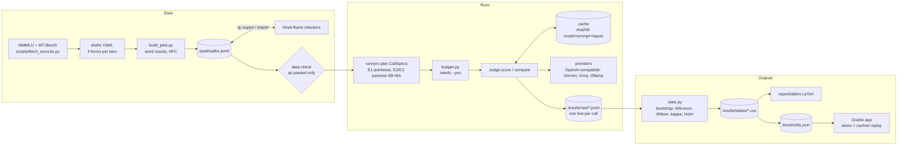

# Design

Key guarantees

- **No invented outputs.** Numbers come only from `results/raw` → `stats.py` → `results/tables`.
- **Cache-first.** Every call is keyed by sha256(model, full prompt, {temperature, attempt}). A hit never
  calls the provider; `--offline` turns a miss into an error, which is how `make reproduce` and the app's
  demo mode stay network-free.
- **Budget gate.** Runners enumerate the exact calls, print new vs cached counts, and stop without `--yes`.
- **Order control.** Every pairwise comparison runs AB and BA; both are stored.
- **Self-preference guard.** The drafting model is refused as a judge.
- **UTF-8 everywhere.** Files are opened with `encoding="utf-8"`; QC sheets use a BOM for Excel.
